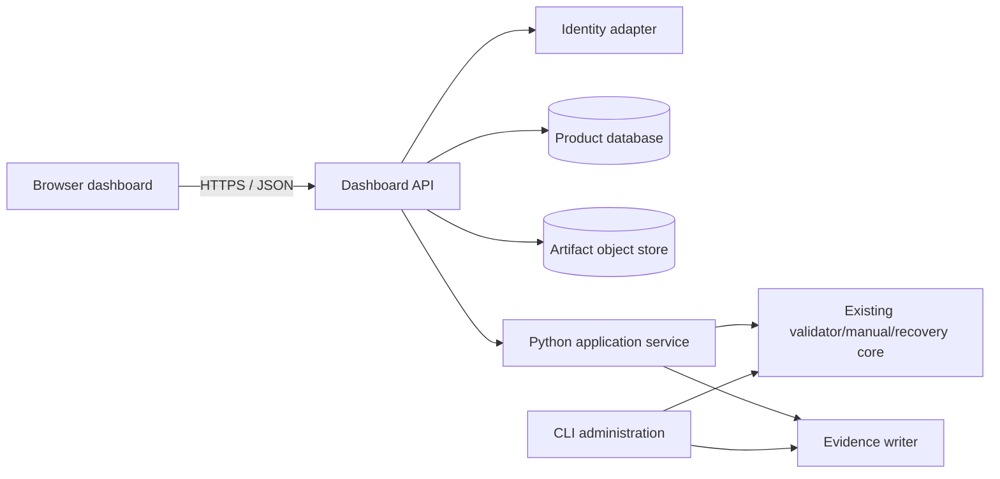

# Customer dashboard product architecture

**Status:** release architecture decision for MEN-036  
**Scope:** the narrow customer-facing web product over the existing Python core  
**Decision:** ship a modular monolith. The web API owns customer interaction and persistence; the dependency-free Python core remains the only owner of workflow validation, planning, policy, evidence semantics, retry, and rollback contracts. The CLI remains the administration and recovery surface.

## 1. Product boundary

The release product supports one complete journey:

1. a customer signs in;
2. selects a workspace and an approved workflow;
3. supplies typed workflow inputs;
4. creates an immutable execution plan through the existing Python core;
5. reviews the plan and resolves required human approvals;
6. records manual node results and artifacts;
7. sees execution status and verifies evidence;
8. creates a bounded retry or a manual rollback plan after failure.

The dashboard does not edit the canonical catalog, change policy, administer users, import corpus content, execute provider tools, publish content, spend money, or perform rollback effects. Those operations remain CLI or operator responsibilities. The first release has no autonomous runtime adapter.

## 2. Component ownership



| Component | Owns | Must not own |
|---|---|---|
| Browser dashboard | presentation, form state, accessible review and approval UI | authorization decisions, policy evaluation, evidence creation, canonical state |
| Dashboard API | authentication enforcement, tenancy, request validation, idempotency, persistence transactions, API resource lifecycle | workflow semantics duplicated from the Python core |
| Python application service | translation between persisted product records and existing `menaxvi.manual`, `menaxvi.recovery`, `core.policy`, and `core.evidence` contracts | HTTP, cookies, browser sessions, tenant discovery |
| Existing Python core | catalog validation, deterministic plans and records, digests, gates, retry limits, rollback instructions, evidence redaction and hash-chain rules | customer identity or database persistence |
| Product database | users, workspaces, memberships, sessions, executions, approval records, artifact metadata, idempotency keys | artifact bytes, secrets, mutable copies of canonical catalog resources |
| Artifact object store | immutable customer inputs and outputs addressed by digest | policy decisions or executable catalog content |
| CLI | catalog/release administration, diagnosis, evidence verification, break-glass recovery | ordinary customer interaction |

The API calls core functions in-process for the first release. A networked core service is deferred until independent scaling or isolation is measured as necessary. This avoids a second deployment boundary and preserves deterministic behavior.

## 3. Domain model

All identifiers are server-generated opaque UUIDs. All mutable rows carry `version`, `created_at`, and `updated_at`. Tenant-owned rows include `workspace_id`; every query is scoped by the authenticated workspace before lookup.

- **User** — identity-provider subject, display metadata, disabled state.
- **Workspace** — customer tenant and retention boundary.
- **Membership** — user/workspace relation with `viewer`, `operator`, or `owner` role.
- **WebSession** — hashed rotating refresh token, expiry, revocation, and last-seen metadata. Browser cookies contain no authorization state.
- **Execution** — workflow reference, lifecycle state, input artifact reference, immutable plan digest, current attempt, creator, and optimistic version.
- **Attempt** — immutable execution ID, plan document, result record, status, and predecessor attempt for retries.
- **Approval** — execution ID, gate ID, decision, approver, decision time, expiry, version, digest, and optional reason. There is at most one active decision per execution/gate/version.
- **Artifact** — immutable metadata: owner workspace, media type, byte size, SHA-256 digest, storage key, classification, producer, and retention state.
- **EvidenceEvent** — append-only event envelope with sequence, previous hash, event hash, actor, request correlation ID, and redacted data.
- **IdempotencyRecord** — workspace, actor, operation, key, request digest, response reference, and expiry.

Execution states are explicit:

```text
draft → planned → awaiting_approval → ready → recording → succeeded
                              └──────────────→ rejected
recording → failed | incomplete
failed | incomplete → retry_planned
failed | incomplete | succeeded → rollback_planned
```

Illegal transitions return `409 conflict` and do not mutate state. A retry creates a new `Attempt`; it never overwrites the failed record. A rollback creates instructions only and records `automaticActionsPerformed: false`.

## 4. API contract and ownership

The versioned API prefix is `/api/v1`. JSON responses include `requestId`; errors use stable codes and do not expose stack traces. Mutation endpoints require an `Idempotency-Key` and use `If-Match` with the resource version where concurrent decisions are possible.

| Endpoint | Purpose |
|---|---|
| `GET /workspaces` | list memberships visible to the signed-in user |
| `GET /workspaces/{workspaceId}/workflows` | list active, validated workflows available from the approved catalog |
| `POST /workspaces/{workspaceId}/executions` | validate inputs and create the immutable core plan |
| `GET /workspaces/{workspaceId}/executions/{executionId}` | return state, gates, attempts, artifact metadata, and evidence verification summary |
| `POST /workspaces/{workspaceId}/executions/{executionId}/approvals` | record one signed approval or rejection for a gate |
| `POST /workspaces/{workspaceId}/executions/{executionId}/results` | validate and record manual results through `record_results` |
| `POST /workspaces/{workspaceId}/executions/{executionId}/retries` | create a bounded retry through `create_retry_plan` |
| `POST /workspaces/{workspaceId}/executions/{executionId}/rollback-plans` | create non-executing compensating instructions through `create_rollback_plan` |
| `POST /workspaces/{workspaceId}/artifacts` | issue a bounded upload and register digest-verified metadata |
| `GET /workspaces/{workspaceId}/executions/{executionId}/evidence` | stream redacted evidence and verification state |

The API may orchestrate transactions but cannot reimplement digest, approval, retry, rollback, or evidence rules. Core errors are mapped to stable API errors; unexpected core failures return `500 core_failure`, append a failure event without sensitive inputs, and leave the prior state intact.

## 5. Authentication and authorization

Use an OpenID Connect authorization-code flow with PKCE. The API validates issuer, audience, signature, nonce, state, and token times. The browser receives `Secure`, `HttpOnly`, `SameSite=Lax` session cookies. CSRF tokens are mandatory for state-changing requests. Refresh tokens are rotated and stored only as hashes; logout and account disablement revoke sessions.

Authorization is deny-by-default:

- `viewer`: read executions, artifacts, and evidence metadata;
- `operator`: viewer rights plus create plans, upload artifacts, record results, and request retry/rollback plans;
- `owner`: operator rights plus workspace membership administration;
- approval additionally requires an active membership and a gate-specific approver assignment; workspace role alone is insufficient.

The API never accepts workspace, actor, approval owner, or policy outcome from browser claims without server-side resolution. Cross-workspace resource IDs return `404` to avoid tenant enumeration. Security-relevant authorization outcomes are evidence events.

## 6. Persistence and consistency

Use PostgreSQL as the transactional source of truth and an S3-compatible object store for artifact bytes. Local development may use SQLite and filesystem storage only behind the same repository interfaces; production semantics are defined by PostgreSQL.

A single database transaction persists each lifecycle transition, idempotency result, approval decision, artifact metadata link, and an **evidence outbox** entry. A single-writer worker drains the outbox in order into the hash-chained evidence stream. This satisfies `EvidenceLog`'s documented single-writer requirement and avoids a database commit succeeding without durable evidence intent.

Evidence is append-only. Corrections create new events. Artifact uploads are quarantined until size, media type, digest, and malware-policy checks pass. Artifact bytes are immutable after registration; replacement creates a new artifact ID. Database backups and object-store versioning share a documented retention class and restore test.

Canonical catalog content is mounted read-only from the same reviewed release artifact used by the CLI. Executions pin workflow/resource versions and plan digests, so a later catalog release cannot change an existing attempt.

## 7. Approval, evidence, and artifact invariants

1. Policy and human gates are evaluated before any tool selection or result acceptance.
2. Approval records bind to exact `execution_id`, `gate_id`, version, digest, approver, and validity interval.
3. Rejection, expiry, duplicate active approval, untrusted digest, or verifier failure denies the transition.
4. Evidence redaction occurs in the core before persistence; credentials, cookies, tokens, sessions, and secrets are never event data.
5. Every mutation records actor, workspace, request ID, operation, resource version, outcome, and relevant content digests.
6. The UI labels artifact content and model/customer inputs as untrusted data and renders text without executable HTML.
7. Download authorization is checked at request time; object-store keys and permanent public URLs are never exposed.

## 8. Retry and rollback behavior

Retries are available only for `failed` or `incomplete` attempts. The API delegates attempt bounds to `create_retry_plan`, uses a new execution ID, links the predecessor digest, and returns `409 retry_limit_reached` when the core limit is exhausted. Idempotent replay returns the originally created retry.

Rollback is compensating guidance, not automation. The dashboard requires a reason, calls `create_rollback_plan`, displays completed nodes and manual instructions, and requires an operator to acknowledge that external effects have not been reversed. Any later automated compensator requires a separate policy, authorization artifact, approval gate, adapter, and release decision.

## 9. Operational and packaging boundary

Ship three artifacts from one source revision:

1. the existing Python wheel/zipapp and `menaxvi` CLI;
2. one dashboard API container containing the Python application package and pinned read-only catalog;
3. static dashboard assets served by the API or a same-origin CDN.

The deployment is a modular monolith plus managed PostgreSQL and object storage. Run the API and evidence worker as separate process roles from the same image. The API is stateless apart from external stores. Database migrations are forward-only per release and include a tested restore/rollback procedure; application rollout uses expand/migrate/contract compatibility.

Required operational signals:

- request rate, latency, and errors by stable route name;
- authentication and authorization denials without sensitive labels;
- execution transitions and age in `awaiting_approval`/`recording`;
- evidence outbox lag and hash-chain verification failures;
- artifact scan failures and orphaned uploads;
- database, object-store, and worker health.

Alert immediately on evidence verification failure, cross-tenant authorization anomaly, outbox backlog beyond the recovery objective, or repeated core failures. Logs use request IDs and opaque resource IDs; they exclude request bodies, cookies, tokens, approvals' free text, and artifact contents.

## 10. Failure and recovery boundaries

- A core validation or policy error is a customer-correctable `4xx`; no partial execution is created unless a durable draft is explicitly returned.
- A database failure rolls back the lifecycle mutation and evidence outbox together.
- An object upload without committed metadata is garbage-collected after a bounded quarantine period.
- An outbox delivery failure retries with backoff; mutations remain visible with `evidencePending: true` and privileged operations fail closed if evidence lag exceeds the configured bound.
- Corrupt evidence sets the workspace execution surface read-only until an operator verifies or restores the chain through the CLI.
- Backup recovery restores PostgreSQL first, object versions second, then replays/verifies the evidence outbox and chain before reopening writes.

## 11. Observable release acceptance

The dashboard slice is releasable only when automated tests and a real browser journey demonstrate all of the following:

- a user cannot access another workspace by changing a URL or resource ID;
- an operator can create a plan for an approved workflow and the stored plan digest equals the core output;
- invalid inputs and unapproved catalog resources fail before an execution becomes runnable;
- a required gate blocks result recording until one valid assigned approver approves it;
- rejection, expired approval, duplicate approval, and verifier failure all fail closed;
- artifact upload, digest verification, authorized download, and unsafe inline rendering are tested;
- successful result recording produces an immutable record and a valid evidence chain;
- failed/incomplete execution creates a bounded retry with a new attempt and preserves the original;
- rollback produces instructions with `automaticActionsPerformed: false` and performs no external side effect;
- repeated mutation requests with the same idempotency key create one logical result;
- optimistic concurrency prevents two approval or result decisions from silently overwriting each other;
- session expiry, logout, CSRF rejection, and disabled membership are exercised;
- backup restore and evidence-chain verification are documented and tested in a release environment;
- the same packaged catalog and core contract pass CLI and dashboard conformance tests.

## 12. Explicit deferrals

Not in this release: customer catalog editing, arbitrary workflow authoring, autonomous providers, background model execution, billing, public artifact sharing, multi-region active/active writes, per-customer encryption keys, external webhooks, mobile applications, or microservices. Each requires measured demand and a separate threat model and architecture decision.
